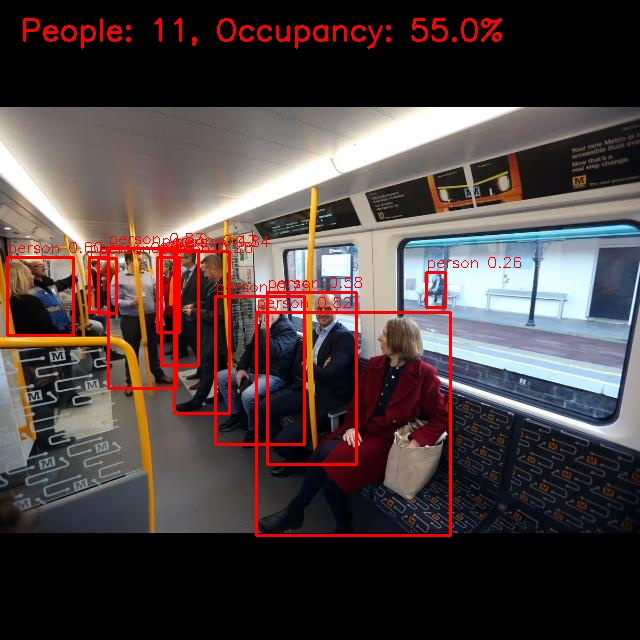
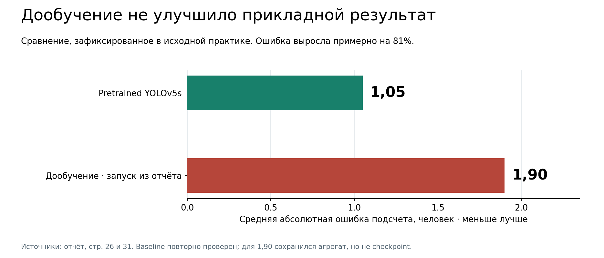
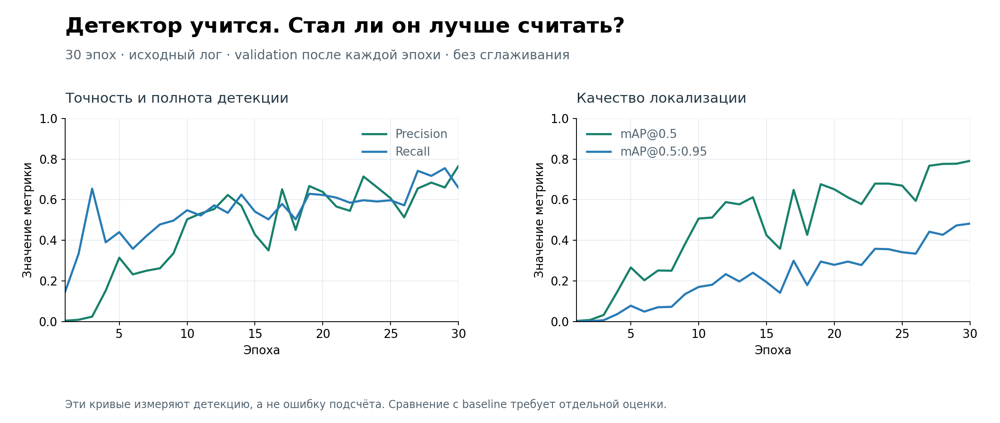
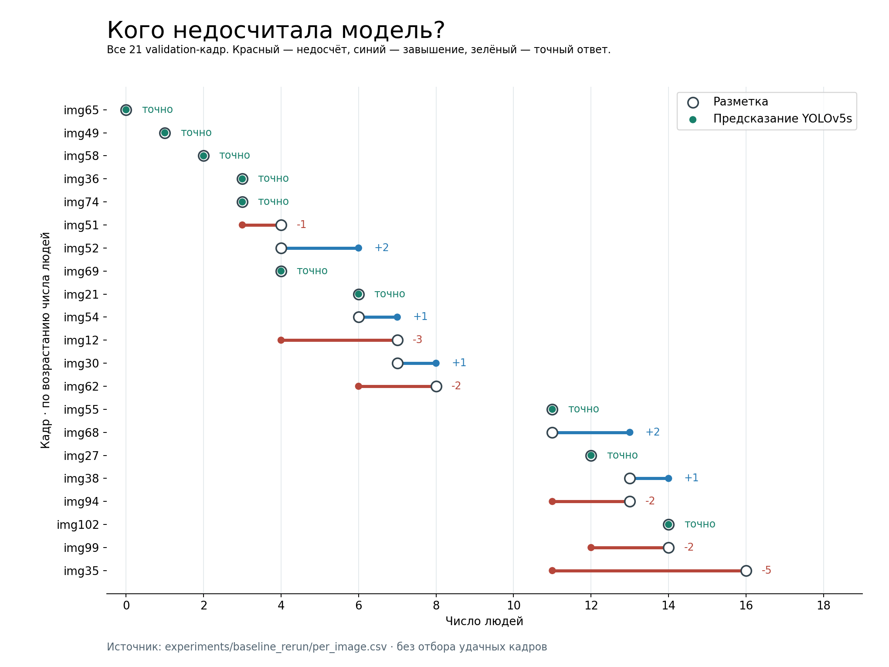

# MetroYOLO — passenger counting research

**When fine-tuning a detector makes the actual counting task worse.**

A study of COCO-pretrained YOLOv5s on metro photographs, covering label preparation,
transfer learning, a shorter training run, postprocessing search and model selection.
[Русский](README.md) · [Full study](docs/research/README.md) ·
[Original notebook](notebooks/metro_experiments.ipynb) · [Source map](docs/SOURCE_MAP.md)



This figure is an unchanged result from the original practice report: 11 detections
and a 55% load index under the study's assumed capacity of 20 visible people.
It is not an interface mockup or a new inference run.

## Experimental design

102 images, 81 train / 21 validation, one class and 838 annotations. YOLOv5s generated
initial labels; they were manually corrected in Roboflow. Ten negative images with
empty labels were retained. Using the baseline to help create evaluation labels
introduces possible teacher bias, even after manual correction.

Four interventions addressed the same question:

1. Establish pretrained YOLOv5s as the baseline.
2. Fine-tune for 30 epochs from pretrained weights.
3. Try a shorter 10-epoch run, as described in the report.
4. Search 350 combinations of confidence, NMS IoU and maximum detections.

## The task result matters more than a single detection score



The report records counting MAE rising from **1.05 to 1.90 people** in one fine-tuned
run, roughly an 81% increase using the rounded values. Load-index error rises from
5.24 to 9.52 percentage points. Baseline results were independently rerun on the supplied
validation split. The 1.90 result survives as a reported aggregate, without its
per-image CSV or checkpoint; the chart labels that distinction.

The original 30-epoch training log reports final best-checkpoint precision 0.766,
recall 0.654, mAP50 0.790 and mAP50–95 0.482. These do not establish better counting.
No baseline mAP was preserved, so a relative mAP improvement is not claimed.




Both figures are reconstructed from real measurements without smoothing. Class
loss is zero in this one-class training setup, not proof of perfect classification.
Training loss and validation detection quality do not directly measure counting error.

## Why fewer epochs and different thresholds were investigated

The report describes a short-run model producing excessive boxes on body parts,
handrails and seats. The saved output labeled 10EPOCH gives MAE 28.62, maximum error
64 and a mean prediction of 36.19 people versus 7.57 in the annotations.
A reused checkpoint path conflicts with the notebook's 30-epoch command, so independent
checkpoint attribution cannot be verified. The experiment is preserved with that limitation.

The postprocessing grid spans 10 confidence thresholds, 7 NMS IoU thresholds and
5 detection caps. According to the report, no tested combination beat the pretrained
baseline. The full historical ranking is unavailable; no invented heatmap or optimal
setting is presented. A cap may make counts look plausible without fixing the boxes.

## Inspect the images behind the mean



The baseline counts 10/21 images exactly and stays within two people on 19/21.
In its worst image it predicts 11 people for 16 annotations, while another image
with 14 people is counted correctly. Average confidence in the worst image is 0.56;
it describes detected boxes and says nothing about missed people.

A missed person and a false detection can cancel out, giving a correct total with
incorrect boxes. Count MAE must therefore be interpreted alongside FP/FN and duplicates.
[Three historical examples and analysis](docs/research/03-findings.md).

The original study selected the pretrained baseline. Limited data, noisy labels and
teacher bias are candidate explanations, not isolated causal findings. The next
experiment needs independently reviewed, scene-separated test data and saved checkpoints.

## Software and use

The research notebook is preserved. A modular Python package provides prediction,
training, dataset validation, threshold search, evaluation and exports. A local app
presents the full study and historical figures, and supports actual photo inference.

Python 3.10–3.12:

```bash
python3 -m venv .venv
source .venv/bin/activate
python -m pip install -e '.[app]'
python -m streamlit run app.py
```

Run `bash scripts/setup_yolov5.sh` for processing your own photo.
[Reproduction](docs/REPRODUCIBILITY.md) · [Executed checks](docs/VERIFICATION.md).

```bash
python -m pip install -e '.[dev,app]'
python -m pytest -q
python -m ruff check .
```

Research basis: the original MIREA practice report and Colab. The full dataset and
weights remain external; three historical report figures are included with provenance.
The load index concerns only the visible area, not true whole-carriage occupancy.
[Dataset](docs/DATASET.md) · [Figure provenance](docs/assets/report/README.md) ·
[GPL-3.0 code license](LICENSE).
