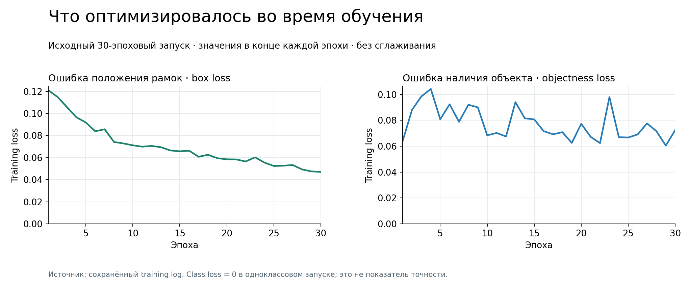

# Четыре проверки одной гипотезы

Гипотеза работы: адаптация COCO-pretrained YOLOv5s к изображениям метро улучшит
подсчёт пассажиров. Она проверялась обучением, изменением длительности обучения
и настройкой постобработки. Эти вмешательства отвечают на разные вопросы.

## Эксперимент A: готовая модель как контроль

YOLOv5s без дообучения обрабатывает 21 validation-изображение. Число рамок person
сравнивается с числом размеченных людей. В отчёте получены MAE 1,05 человека,
максимальная ошибка 5, средние количества 7,19 против 7,57 по разметке.

Повторная оценка на переданном архиве воспроизвела округлённые агрегаты.
[Результаты каждого кадра](../../experiments/baseline_rerun/per_image.csv).
Это подтверждает сохранённый baseline, но не является новым независимым test.

## Эксперимент B: transfer learning, 30 эпох

Начальные веса — yolov5s.pt, один класс person, вход 640 px, batch 16, 30 эпох.
Сохранённый лог подтверждает SGD, seed 0 и Tesla T4. Выбор best.pt выполняется
по detection fitness YOLOv5, а не по ошибке подсчёта людей.

Финальная проверка best.pt: precision 0,766, recall 0,654, mAP50 0,790,
mAP50–95 0,482. Из лога восстановлены реальные значения всех 30 эпох,
включая training box/objectness loss. В одноклассовом запуске class loss равен нулю;
это не означает, что модель идеально распознаёт людей.

Уменьшение box loss показывает оптимизацию функции обучения. Оно само по себе
не гарантирует уменьшения ошибки количества людей на новых изображениях.
Train loss и validation mAP имеют разный смысл, поэтому не показаны как одна шкала качества.

В отчёте на странице 31 зафиксирован прикладной результат одного из запусков:
ошибка **1,90 вместо 1,05 человека**, индекс загрузки **9,52 вместо 5,24 п.п.**
В репозитории это сохранено как reported aggregate: соответствующие CSV и веса
не доступны, поэтому повторный запуск и уверенная привязка к конкретному checkpoint
не заявляются. Разница около 81% относится к округлённым агрегатам отчёта.

## Эксперимент C: более короткое обучение, 10 эпох

Проверялось объяснение «30 эпох могли оказаться слишком долгими»: в отчёте описан
отдельный короткий запуск. Он дал чрезмерное число рамок, в том числе на фрагментах
людей, поручнях и сиденьях. Уменьшение количества эпох не решило проблему.

В сохранённом выводе ячейки `10EPOCH`: среднее предсказание 36,19 человека при
7,57 в разметке, MAE 28,62, максимальная ошибка 64. Это показывает масштаб сбоя,
а не небольшое изменение качества.

Есть проблема прослеживаемости: команда на 30 эпох и оценка с подписью 10EPOCH
ссылаются на одинаковую папку. Отчёт описывает 10-эпоховый эксперимент, но notebook
не позволяет независимо установить происхождение сохранённого checkpoint.
Цифры сохранены с этой оговоркой, а не исключены из истории исследования.

## Эксперимент D: можно ли исправить подсчёт постобработкой

До нового обучения проверяются три управляющих параметра:

- **confidence, 0,25–0,70, 10 значений:** убрать сомнительные рамки, рискуя потерять людей.
- **NMS IoU, 0,15–0,45, 7 значений:** подавить дубли, рискуя удалить рамки соседних людей.
- **max_det, 15/20/25/30/40:** ограничить число результатов, рискуя искусственно обрезать подсчёт.

Всего 350 сочетаний, каждое оценивается на тех же 21 кадре. Настройки ранжируются
по средней ошибке подсчёта, затем по ошибке индекса и максимальной ошибке.
Вторая величина пропорциональна первой при фиксированной вместимости: она
не добавляет независимого критерия выбора.

По отчёту, ни одно сочетание не превзошло baseline. Полный рейтинг не сохранился,
поэтому здесь нет вымышленной тепловой карты или объявленного лучшего порога.
Код сетки сохранён и вынесен в CLI. Ручная визуальная проверка в ноутбуке использует
conf 0,5 / IoU 0,2 / max_det 30; это не доказанный глобальный оптимум.

**Особенность задачи:** cap может сделать число внешне правдоподобным, не исправив
сами детекции. В рабочем пайплайне ограничение нужно проверять вместе с рамками,
а не считать низкую ошибку количества достаточным подтверждением качества.

Источник: отчёт, печатные страницы 22–34; ячейки 3–11 исходного ноутбука.
