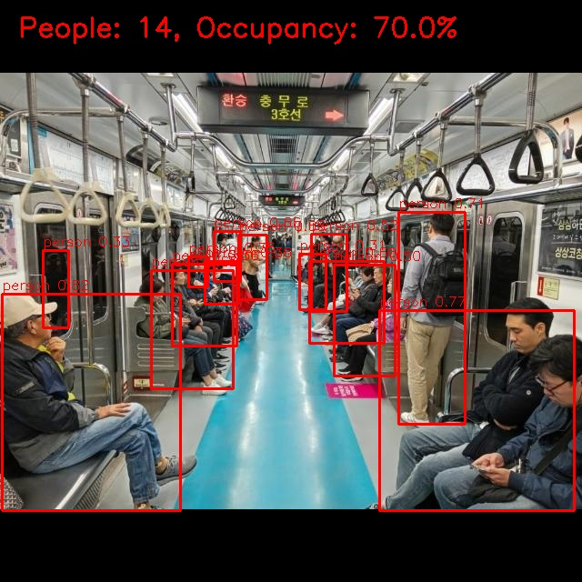
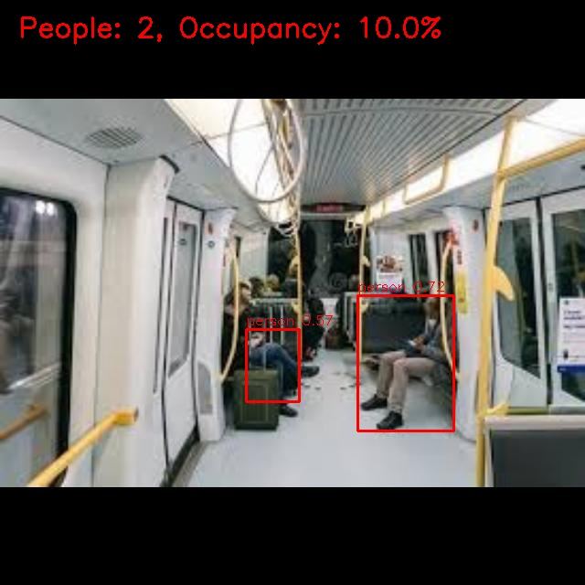

# Почему хорошая детекция ещё не означает хороший подсчёт

## Две ошибки могут взаимно скрыться

Если модель пропустила одного человека и добавила одну лишнюю рамку, итоговое
число людей будет правильным. Count error равен нулю, хотя детекция ошиблась дважды.
В общем случае `predicted − true = FP − FN`, если рамки сопоставлены с объектами
по выбранному правилу. Поэтому одной MAE недостаточно для проверки всех детекций.

Обратная ситуация: модель может улучшать локализацию части объектов, но создавать
больше дублей и хуже считать. mAP и MAE отвечают на разные вопросы. В исходных
материалах нет baseline mAP, поэтому утверждение о росте mAP относительно baseline
не делается. В процессе дообучения validation mAP растёт, но подсчёт по отчёту ухудшается.

## Уверенность не видит пропуски

Confidence есть у найденных рамок. У пропущенного человека рамки нет — и его
неуверенность не попадает в среднее. В худшем baseline-кадре найдены 11 из 16 по
количеству, а средний confidence найденных рамок равен 0,56. Это не оценка вероятности
правильного подсчёта всего кадра. Сравнение средних confidence разных моделей
также не заменяет проверку по разметке.

## Малая ошибка в среднем скрывает разные режимы

На 10/21 кадров подсчёт совпал, на 19/21 отклонение не больше двух людей.
Самая большая ошибка — 5 человек. В другой многолюдной сцене с 14 людьми число
определено точно, поэтому нельзя объяснить все ошибки только плотностью сцены.

## Что видно на примерах из исходной работы

Первый пример: 11 детекций, индекс 55%. В кадре есть перекрытия, дальние люди
и вид через окно. Маленькие рамки и частично видимые тела требуют ручного просмотра.
Число 11 — предсказание на исходной иллюстрации, не независимо проверенный эталон.

Второй пример: 14 детекций, индекс 70%. Перспектива прохода создаёт большой
разброс масштабов: ближний пассажир занимает значительную часть кадра,
дальние люди представлены маленькими областями. Это объясняет необходимость
разнообразных примеров в данных, но само по себе не доказывает конкретную причину ошибок.

Третий пример: 2 детекции, индекс 10%. Пустая часть вагона полезна для проверки
ложных срабатываний на сиденьях и конструкциях. Эти иллюстрации перенесены из отчёта
без изменения рамок; это исторические результаты, а не новые запуски.

## Как интерпретировать итог

В исходной работе выбран pretrained baseline: обучение и рассмотренная постобработка
не дали более надёжного прикладного решения. Кандидаты на объяснение — малый объём
данных, шум разметки, преимущество teacher-модели при оценке и особенности NMS.
Они обсуждаются как возможные факторы; контролируемого разделения их влияния не проводилось.

Следующая проверка — независимая ручная разметка test и сцены, не встречавшиеся в train.
Сохранить веса и детекции каждого варианта, затем разобрать FP/FN и дубли вместе с MAE.
Это позволит проверить причины, а не просто ещё раз увеличить количество эпох.
